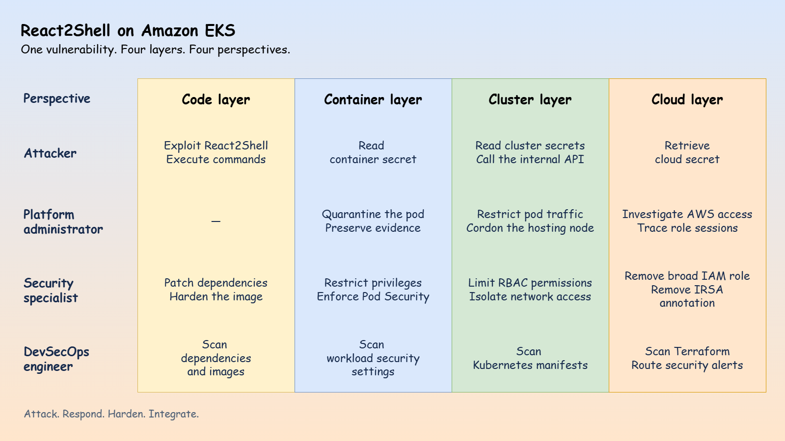
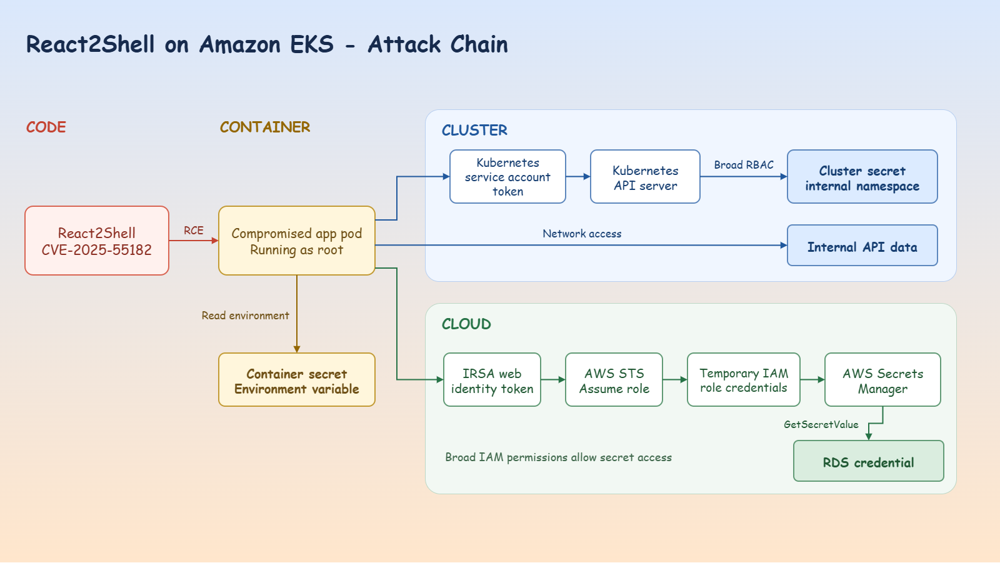
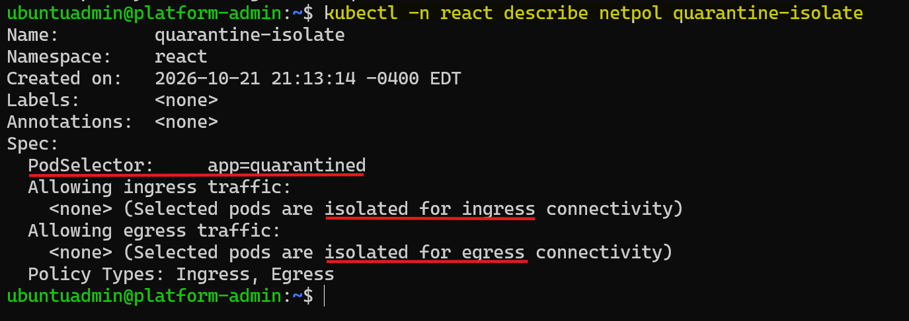
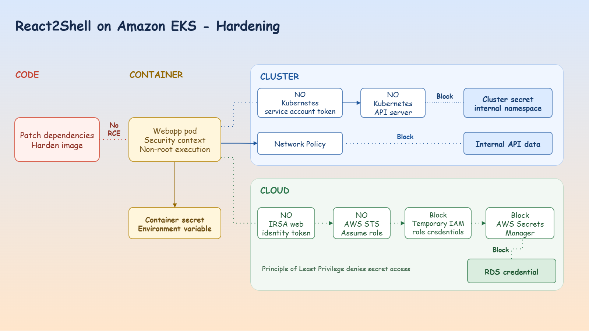

# `React2Shell` on `Amazon EKS`

> One vulnerability. Four layers. Attack, Respond, Harden, Integrate.

A `Kubernetes` security project that exploits **React2Shell (CVE-2025-55182)** in a `Next.js` application on `Amazon EKS`, investigates the breach, tests layered defenses, and integrates security into delivery.

**Layers:** code, container, cluster, and cloud.

     

- [`React2Shell` on `Amazon EKS`](#react2shell-on-amazon-eks)
  - [Security and Business Challenge](#security-and-business-challenge)
  - [Attack — Application Breach with `react2shell`](#attack--application-breach-with-react2shell)
  - [Respond — Investigation and Containment](#respond--investigation-and-containment)
  - [Harden — Defense in Depth](#harden--defense-in-depth)
  - [Integrate — DevSecOps](#integrate--devsecops)
  - [Demo Documentation](#demo-documentation)

---

## Security and Business Challenge

- AI accelerates application delivery, but security misconfigurations can turn a single application flaw into a breach across container, cluster, and cloud resources.

> How can teams maintain delivery speed while containing breaches and integrating security across all four layers?

This project traces a `React2Shell` breach on `Amazon EKS` and tests the defenses across:

- **Four layers**: `code`, `container`, `cluster`, and `cloud`.
- **Four perspectives**: `attacker`, `platform administrator`, `security specialist`, and `DevSecOps engineer`.

---

## Attack — Application Breach with `react2shell`

An attacker exploits `React2Shell` to execute commands inside the application container.

The breach exposes container secrets, Kubernetes resources, an internal API, and a dummy RDS credential in `AWS Secrets Manager` through an overly permissive `IRSA` role.

- Attack chain across code, container, cluster, and cloud

- Container secret exposed through the compromised application

---

## Respond — Investigation and Containment

The platform administrator traces credential access using `CloudTrail` events and pod logs.
Pause `Argo CD` reconciliation, preserve evidence, isolate the pod, and document the incident.

- CloudTrail evidence of suspicious role activity

- Pod isolation through blocked ingress and egress

---

## Harden — Defense in Depth

The security specialist removes broad cloud permissions, restricts `RBAC`, enforces `NetworkPolicies`, and hardens pod security settings.

Replaying the attack after each change shows where access is blocked. Patching the application and using a non-root distroless image complete the hardening.

- Defenses across code, container, cluster, and cloud

---

## Integrate — DevSecOps

**Shift left:** the DevSecOps engineer adds `Trivy` checks in `GitHub Actions` for dependencies, images, Kubernetes manifests, and Terraform.
**Monitoring:** cloud audit logs support investigation; a sample finding verifies the `GuardDuty → EventBridge → SNS` alert path.

- GitHub Actions workflow: build, scan, and publish

---

## Demo Documentation

- [Attacker: exploit React2Shell and access secrets](./docs/demo01_eks_breach.md)
- [Platform administrator: investigate and contain the breach](./docs/demo02_incident_response.md)
- [Security specialist: harden and verify all four layers](./docs/demo03_hardening_eks.md)
- [DevSecOps engineer: integrate security checks and monitoring](./docs/demo04_devsecops.md)
