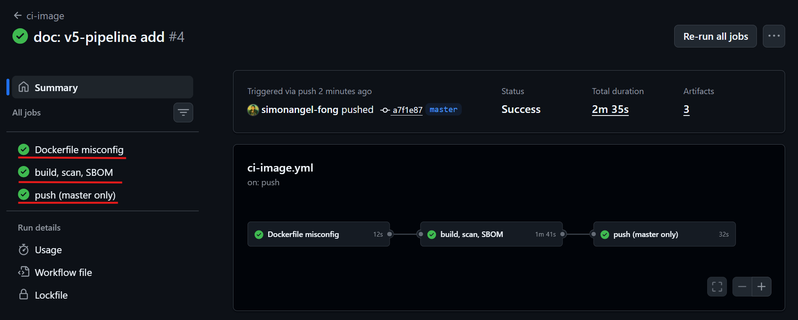
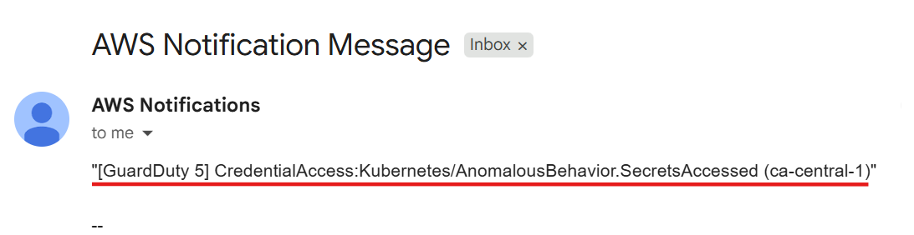

# reat2shell: Shift left and Shift right

[Back](../README.md)

- [reat2shell: Shift left and Shift right](#reat2shell-shift-left-and-shift-right)
  - [Overview](#overview)
  - [Shift left with CI/CD pipeline](#shift-left-with-cicd-pipeline)
  - [Monitoring: CloudWatch + CloudTrail + GuardDuty](#monitoring-cloudwatch--cloudtrail--guardduty)
    - [GuardDuty - Detection Example](#guardduty---detection-example)
  - [Advanced](#advanced)
    - [Policy as code](#policy-as-code)
    - [Sensitive data handling](#sensitive-data-handling)
    - [AWS built-in observability services](#aws-built-in-observability-services)
    - [Provider-agnostic monitoring](#provider-agnostic-monitoring)

---

## Overview

- Perspective: Cluster security specialist
- Goal: show how to integrate security pratices into SDLC
- Environment:
  - infra: eks-secure
  - manifests: insecure-apps
- Url: `http://react2shell.arguswatcher.net:3000`

---

## Shift left with CI/CD pipeline

- `Shift left`
  - a practice of moving critical practices—like security, testing, and compliance—earlier in the software development lifecycle (SDLC).

- Common security concerns

| Security concern               | Layers              | Solution   |
| ------------------------------ | ------------------- | ---------- |
| SAST                           | code                | trivy scan |
| image                          | code                | trivy scan |
| Software Supply Chain Security | code                | trivy SBOM |
| k8s manifest                   | container & cluster | trivy scan |
| trraform codes                 | cloud               | trivy scan |

- Integrated with GitHub Action workflows

| GitHub workflow   | Security concern        | Trigger paths                       | Gate                                          |
| ----------------- | ----------------------- | ----------------------------------- | --------------------------------------------- |
| `ci-code.yml`     | SAST; dependency CVEs   | `app/react2shell-secure/**`         | HIGH/CRITICAL                                 |
| `ci-image.yml`    | image; SBOM s           | `app/Dockerfile.secure`, app source | HIGH/CRITICAL; push only after scan           |
| `ci-manifest.yml` | k8s manifest misconfig; | `argocd/secure-apps/react.yaml`     | HIGH/CRITICAL;                                |
| `ci-iac.yml`      | Terraform codes         | `infra/eks-secure`                  | gate `eks-secure`; report-only `eks-insecure` |

- example

```sh
# trigger workflows with secure branch
gh workflow run ci-code.yml --ref secure
gh workflow run ci-image.yml --ref secure

# inspect a failed gate
gh run view --log-failed
```



---

## Monitoring: CloudWatch + CloudTrail + GuardDuty

- `CloudWatch`:
  - Operational monitoring, metrics, and health
  - What is failing or degrading?
- `GuardDuty`:
  - Auditing, governance, and compliance
  - Who did what, when, and from where?
- `GuardDuty`:
  - Intelligent threat detection and security monitoring
  - Is there malicious or anomalous activity?

### GuardDuty - Detection Example

- Real detection needs ~7-14 days of baseline
- Example:
  - create a sample finding to simulate the abnormal detection.
  - sample finding -> EventBridge -> `SNS` emails

---

- confirm

```sh
# confirm runtime agent landed
kubectl -n amazon-guardduty get pods
# NAME                        READY   STATUS    RESTARTS      AGE
# aws-guardduty-agent-2wvm6   1/1     Running   6 (11m ago)   16m
# aws-guardduty-agent-9n5kx   1/1     Running   6 (12m ago)   16m
# aws-guardduty-agent-d8wsf   1/1     Running   6 (11m ago)   16m

# get detector id
DETECTOR=$(terraform -chdir=infra/eks-insecure output -raw guardduty_detector_id)

# create a sample findings for secret Accessed
aws guardduty create-sample-findings --detector-id $DETECTOR \
  --finding-types CredentialAccess:Kubernetes/AnomalousBehavior.SecretsAccessed

# confirm sample finding created
IDS=$(aws guardduty list-findings --detector-id $DETECTOR --query 'FindingIds' --output text)
aws guardduty get-findings --detector-id $DETECTOR --finding-ids $IDS \
  --query 'Findings[].{type:Type,sev:Severity}' --output table

# [
#     {
#         "type": "CredentialAccess:Kubernetes/AnomalousBehavior.SecretsAccessed",
#         "sev": 5.0
#     }
# ]
```



---

## Advanced

### Policy as code

- `Policy as code`:
  - the practice of managing security and compliance rules using code artifacts.
  - benefits:
    - manage via GitOps
    - reduce manual approval work
    - support compliance audits
  - Popular tools:
    - [Kyverno](https://kyverno.io/docs/introduction/)
    - [OPA](https://www.openpolicyagent.org/docs)
    - [Gatekeeper](https://open-policy-agent.github.io/gatekeeper/website/docs/).
  - Common use cases:
    - check infrastructure policies in CI,
    - reject privileged Kubernetes workloads,
    - restrict image registries
    - requires ownership or cost-center labels.

---

### Sensitive data handling

- [External Secrets Operator (ESO)](https://external-secrets.io/latest/) + `AWS Secrets Manager`
  - Define sensitive data in `AWS Secrets Manager`
  - `ESO` can synchronize values from AWS Secrets Manager into Kubernetes Secrets, leaving only references in manifests.
  - Benefit:
    - separates credential management from application delivery and supports centrally managed secret updates.

---

### AWS built-in observability services

- `VPC Flow Logs`
  - used to record network traffic metadata

- `CloudWatch Logs Insights`
  - supports queries into traffic patterns and rejected connections.

---

### Provider-agnostic monitoring

- `Falco`
  - an open-source, cloud-native runtime security and threat detection engine
  - common use cases:
    - Detecting Container Intrusions & Compromises
    - Monitoring Unauthorized Data & File Access
    - Guarding Against Privilege Escalation
- `LGTM (Loki, Grafana, Tempo, Mimir)`
  - an open-source, vendor-agnostic observability and monitoring tech stack
  - brings together logs, dashboards, traces, and metrics.
